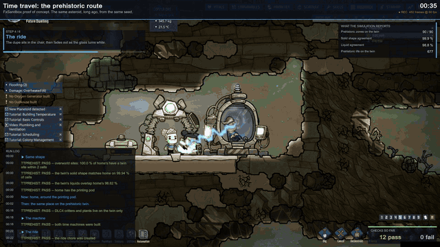
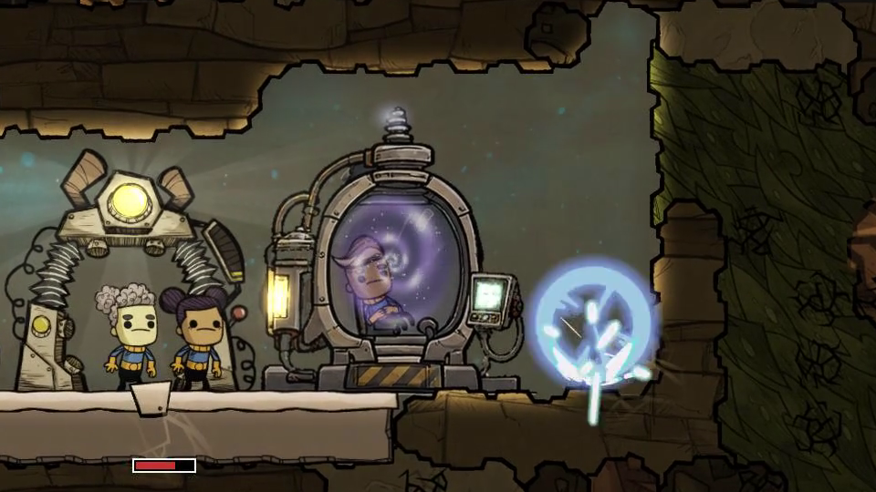
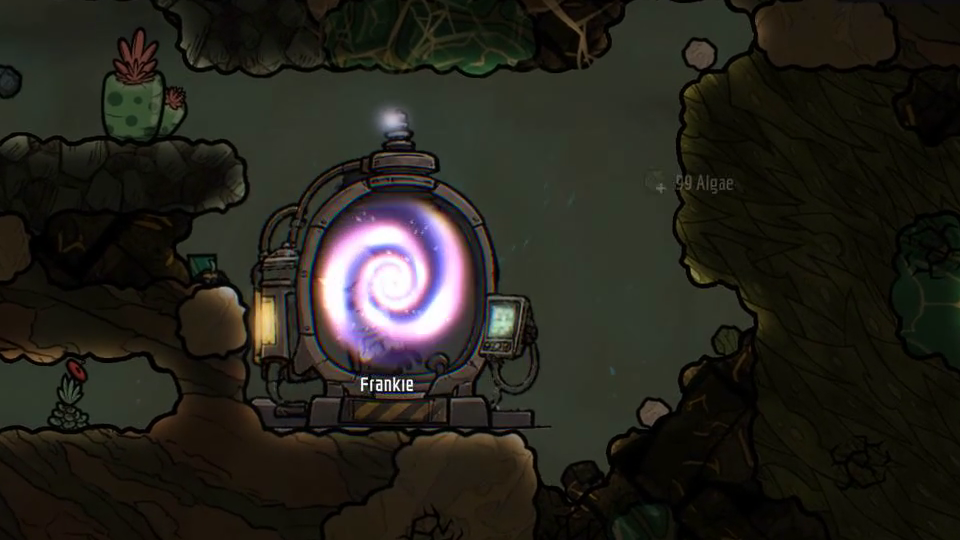

# Time Travel

> [!WARNING]
> **Very early alpha.** This mod is not on the Steam Workshop, and will not be until it is out of
> alpha. Install it by hand from the release zip. Expect things to break, and expect updates that
> cannot load saves made with an earlier version. Please report problems in this repository's issues.

A time machine for Oxygen Not Included. A duplicant takes a seat, the machine charges, and the
duplicant arrives on a prehistoric version of your home asteroid (a placeholder destination, see
[Status](#status)): a second world generated from the same seed as your colony's, with its biomes
converted to those of The Prehistoric Planet Pack. The machine then needs to cool down before the
duplicant can ride it back. The cooldown runs on the game clock, so it pauses with the game and is
kept in the save.

Built on the ONI Framework Library (`OniFramework.Library`), the part of the
[ONI simulation SDK](https://github.com/Salacious-Oni-Dev)'s API that runs on the game's own simulation.

## What it looks like

A duplicant takes the seat, the machine flashes, and the duplicant arrives on the prehistoric twin.
The stills show the ride starting at home, and the wormhole open on the twin for the ride back.
Recorded by the automated run; the [full run](https://github.com/Salacious-Oni-Mods/oni-time-travel/releases/download/v0.7.0/time-travel-run.mp4)
(1 min 28 s) also shows the save and reload, the cooldown and the ride back.

## Status

Alpha, version 0.7.0. Playable in a normal game, with no command-line flag. The code is in `mod/`.

The prehistoric world is a placeholder destination. Once the SDK's determinism work is done, the
machine will travel to earlier points of your own colony, and to its future. The machine's build
recipe is a placeholder too: the real one will need exotic materials from the new systems and
elements the SDK adds.

## Requirements

- The `OniFramework.Library` mod, library version 1.2 or later, from the
  [oni-framework-api](https://github.com/Salacious-Oni-Dev/oni-framework-api) release 0.1.0-alpha.2.
  It does not need the `OniFramework` mod or the SDK's replacement `SimDLL.dll`. See
  [Installing and removing](https://github.com/Salacious-Oni-Dev/oni-sdk-docs/blob/main/guides/installing.md).
- Spaced Out! and The Prehistoric Planet Pack.
- For the machine's blue bolts, The Bionic Booster Pack (see [The bolts](#the-bolts)). Without it
  the machine works and fires no bolts.
- A new game. The prehistoric world is generated together with your home world when the game
  is created, so the mod cannot be added to an existing save.

## Playing it

1. Start a new game and pick the **TIME TRAVEL** card. It generates two asteroids: Terra, and
   Prehistoric Terra, the same Terra long ago.
2. Build a **Time Machine** (Equipment menu) on Terra. Its partner is built for you at the same
   place on the prehistoric twin, in a cleared pocket, and the area around it is revealed.
3. Select the machine and press **Time Travel**. A duplicant walks to the seat, rides, and arrives
   in the partner machine on the twin. Press **Time Travel** on the twin's machine to ride back.
4. After a ride both machines recharge for 5 cycles. The recharge is kept in the save; the button
   says how long is left.

A ride brings a white pulse, a warp swirl, screen shake and blue bolts. The bolts can damage nearby
walls (very firm materials and the floor under the machine are immune) and, now and then, a nearby
duplicant for 5 HP, never below 10 HP and never the rider. With Spaced Out the machine also gives
off radiation while it charges and holds.

## The bolts

The machine's blue bolts are made when the game loads, as a separate copy of the stress-shock beam
art from the player's own installed copy of The Bionic Booster Pack, recoloured for the time
machine. The game's original bolts are not changed; the stress-shock effect looks exactly as it did
before. The recolour happens on your machine at runtime; no art of Klei's is distributed with this
mod.

## Testing

An automated new-game run covers the whole ride: the twin generated from home's seeds with every
biome converted, the partner machine built and linked, the ride there and back, the bolts and
radiation, and the cooldown surviving a save and reload. The Time Machine is a normal building from
the Equipment menu (placeholder recipe: any metal, see [Status](#status)), and it builds its own
partner on the twin whichever way it is placed. The automated run places the machine from code
instead of having a duplicant build it, and starts the ride from code instead of pressing the
button; from the moment the machine exists, the same code runs either way. The **Time Travel**
button itself has been checked by hand only.

**By hand:** start a new game with the **TIME TRAVEL** card, build a **Time Machine** from the
Equipment menu (any metal), and wait for its partner to appear on the twin. Select the machine and
press **Time Travel**; after 5 cycles, press **Time Travel** on the twin's machine to ride back.

**Automated:** the run is `mod/FxTtPrehistRig.cs`, built only with `-p:FxDevRigs=true` (see
`mod/FxSandbox.csproj`). On a development build of the game it is started with
`--framework-newgame FxTimeTravel --framework-newgame-seed <n> --fx-ttprehist --mod1-record`, and a
passing run ends its log with `RIG-VERDICT rig=TTPREHIST outcome=PASS` and `fail=0`. This run needs the
development build: the `--framework-newgame` and `--mod1-record` flags are not part of the public
Alpha 2, so the by-hand recipe above is the one that works from these sources.

## Building

Clone [oni-framework-api](https://github.com/Salacious-Oni-Dev/oni-framework-api) beside this
repository and build it once with its `build.sh`. Then, with `ONI_GAME` set to the game's folder
(the one that contains `OxygenNotIncluded_Data`):

    cd mod
    dotnet build -c Release

The mod lands in `mod/bin/Release/`. Its two screen shaders in `shaders/` are built into the
`fxsandbox-shaders` bundle with Unity 6000.3.5f2, the editor version the game uses, and the bundle
goes beside `FxSandbox.dll`. The release zip carries both.

## License

MIT, see `LICENSE`.

## Credits

Oxygen Not Included is developed and published by Klei Entertainment. This project is not
affiliated with or endorsed by Klei.
How this project follows Klei's modding guidelines, rule by rule: [COMPLIANCE](https://github.com/Salacious-Oni-Dev/oni-sdk-docs/blob/main/COMPLIANCE.md).

Development of this project uses AI coding assistants. All changes are reviewed, tested and
released by the maintainer.

The time machine's building sprite is a placeholder generated with an AI image tool. It will be
replaced by original art.
